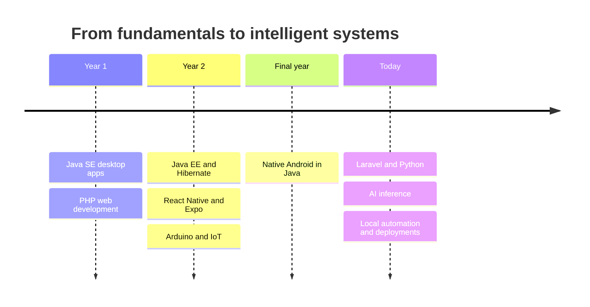
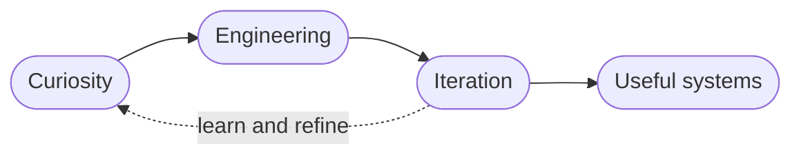

<div align="center">


<a href="https://github.com/adreysanjunadel"></a>

<p>


</p>

<p>
<a href="https://www.linkedin.com/in/sanjuna-delpitiya-40b5202a1/"></a>
<a href="mailto:sanjunadelpitiya1@gmail.com"></a>
<a href="https://github.com/adreysanjunadel?tab=repositories"></a>

</p>

<p>
<a href="#whoami">whoami</a> &nbsp;·&nbsp;
<a href="#focus">focus</a> &nbsp;·&nbsp;
<a href="#toolkit">toolkit</a> &nbsp;·&nbsp;
<a href="#projects">projects</a> &nbsp;·&nbsp;
<a href="#journey">journey</a> &nbsp;·&nbsp;
<a href="#connect">connect</a>
</p>

</div>

<br/>

<h2 id="whoami">&gt; whoami</h2>

```bash
$ whoami
adrien-sanjuna

$ cat profile.json
{
  "role":       "Software Engineer (BSc Software Engineering)",
  "location":   "Colombo, Sri Lanka (UTC+05:30)",
  "company":    "Cornerstone Solutions",
  "roots":      ["Java / Java EE", "PHP", "Mobile development"],
  "today":      ["Laravel", "Python", "JavaScript / TypeScript", "AI-assisted development", "Practical automation"],
  "building":   "software that is understandable, useful and maintainable",
  "philosophy": "purpose-built, lightweight tools over unnecessary complexity"
}
```

I work across **backend systems, full-stack applications, AI inference, local automation and deployment workflows**. I enjoy connecting software to real-world engineering problems, from connected devices and business platforms to workflows that are easier to review, maintain and scale.

> 💡 *I care about solutions that do more than run: they should be **understandable, useful, and maintainable**.*

<br/>

<h2 id="focus">⚡ What I'm focused on</h2>

<table>
  <tr>
    <td width="50%" valign="top">
      <h3>🖥️ Backend &amp; web platforms</h3>
      <p>PHP / Laravel, Java / Java EE, Hibernate, APIs, databases and application workflows.</p>
    </td>
    <td width="50%" valign="top">
      <h3>🧠 Applied AI &amp; inference</h3>
      <p>Python-based experimentation, inference integration, and learning how neural networks work from first principles.</p>
    </td>
  </tr>
  <tr>
    <td width="50%" valign="top">
      <h3>🔁 Automation &amp; deployment</h3>
      <p>Local scripts, repeatable developer workflows, Linux tooling, application deployment and operational troubleshooting.</p>
    </td>
    <td width="50%" valign="top">
      <h3>📐 Engineering automation</h3>
      <p>Exploring how software can assist engineering design processes, data checks, drawing reviews and human-in-the-loop validation.</p>
    </td>
  </tr>
  <tr>
    <td colspan="2" valign="top">
      <h3>📱 Mobile &amp; connected systems</h3>
      <p>Android (Java), React Native / Expo, Arduino and IoT integrations.</p>
    </td>
  </tr>
</table>

<br/>

<h2 id="toolkit">🧰 Technical toolkit</h2>

<table>
  <tr>
    <td width="30%" valign="middle"><b>Languages &amp; backend</b></td>
    <td valign="middle"></td>
  </tr>
  <tr>
    <td valign="middle"><b>Frontend &amp; mobile</b></td>
    <td valign="middle"></td>
  </tr>
  <tr>
    <td valign="middle"><b>Tooling &amp; hardware</b></td>
    <td valign="middle"></td>
  </tr>
</table>

<details>
<summary><b>The full toolkit</b></summary>

<br/>

`Java EE` · `Servlets` · `JSP` · `Hibernate ORM` · `REST APIs` · `React Native / Expo` · `SQL` · `GitHub` · `local development environments` · `debugging & deployment`

</details>

> 🧪 **Honest note:** Angular / TypeScript and neural-network fundamentals are active learning interests, not claimed specializations.

<br/>

<h2 id="projects">🚀 Selected public projects</h2>

*These repositories trace the foundations of my work, from Java applications and mobile development to full-stack systems and connected hardware.*

<table>
  <tr>
    <td width="50%" valign="top">
      <h3>🎵 Golden Octaves</h3>
      <p><b>Music eCommerce platform</b></p>
      <p>Product discovery, account workflows, shopping cart and checkout integration.</p>
      <p></p>
      <p><sub><b>Java EE · Hibernate · JS · Bootstrap</b></sub></p>
      <p><a href="https://github.com/adreysanjunadel/year2_java_web_hibernate_music_shop"></a></p>
    </td>
    <td width="50%" valign="top">
      <h3>📡 WiMapsX</h3>
      <p><b>Connected IoT system</b></p>
      <p>Combines a mobile interface, connected hardware and a Java-backed application.</p>
      <p></p>
      <p><sub><b>Arduino · React Native / Expo · Java · Hibernate</b></sub></p>
      <p><a href="https://github.com/adreysanjunadel/year2_expo_wifi_iot_project"></a></p>
    </td>
  </tr>
  <tr>
    <td width="50%" valign="top">
      <h3>💬 VChat</h3>
      <p><b>Mobile chat app</b></p>
      <p>A mobile chat application built on a Java / Hibernate-backed architecture.</p>
      <p></p>
      <p><sub><b>React Native / Expo · Java · Hibernate</b></sub></p>
      <p><a href="https://github.com/adreysanjunadel/year2_expo_hibernate_chatapp"></a></p>
    </td>
    <td width="50%" valign="top">
      <h3>🚚 Android Delivery Management</h3>
      <p><b>Final-year Android application</b></p>
      <p>Explores delivery management, mobile UI and animations.</p>
      <p></p>
      <p><sub><b>Android · Java</b></sub></p>
      <p><a href="https://github.com/adreysanjunadel/final_yr_android_delivery_app"></a></p>
    </td>
  </tr>
</table>

<details>
<summary><b>📚 Earlier projects &amp; academic foundations</b></summary>

<br/>

| Project | What it is |
| :--- | :--- |
| [PHP Hotel Web Project](https://github.com/adreysanjunadel/year1_php_hotel_web_project) | Early PHP web application |
| [Java SE Library Management System](https://github.com/adreysanjunadel/year1_java_se_library_sys) | Group desktop application |
| [Java SE Student LMS](https://github.com/adreysanjunadel/year1_java_se_student_lms) | Student-management fundamentals |
| [Java SE Calculator](https://github.com/adreysanjunadel/year1_java_se_calculator) | Foundational Java desktop project |

</details>

<br/>

<h2 id="journey">🗺️ The journey so far</h2>



<br/>

## 🧠 Beyond the public repositories

Some of my more recent work and exploration isn't represented by a public repository yet. My current direction:

<table>
  <tr>
    <td width="50%" valign="top">
      <h3>🐘 Laravel &amp; Python</h3>
      <p>Backend application development, scripting and integrations.</p>
    </td>
    <td width="50%" valign="top">
      <h3>🤖 AI inference &amp; developer tooling</h3>
      <p>Practical AI workflows, including reusable AI-assisted codebase mapping and analysis.</p>
    </td>
  </tr>
  <tr>
    <td width="50%" valign="top">
      <h3>⚙️ Local automation &amp; deployments</h3>
      <p>Reducing repetitive work, managing environments and solving deployment issues.</p>
    </td>
    <td width="50%" valign="top">
      <h3>📐 Cross-disciplinary engineering</h3>
      <p>Automating engineering documentation, model information, drawing review and checks that keep engineers in control.</p>
    </td>
  </tr>
</table>

<br/>

## 🧭 How I build



- **Clarity over cleverness:** clear architecture and a sensible developer experience.
- **Lightweight over bloated:** purpose-built tools beat unnecessary complexity.
- **Humans in the loop:** automation should assist engineers, not bypass their judgment.
- **Maintainable by default:** if it can't be understood and reviewed, it isn't finished.

<br/>

## 📊 GitHub at a glance

<div align="center">


<br/>


</div>

<br/>

## 🌱 Learning &amp; exploring

<div align="center">


</div>

<br/>

Outside code, I'm into **Formula 1 and circuit design 🏎️**, **music 🎶** and **hardware / IoT experimentation 🔌**: places where engineering, creativity and precise systems thinking meet.

<br/>

<h2 id="connect">🤝 Let's connect</h2>

I'm interested in conversations and collaborations around **backend development, applied AI, automation, mobile systems, IoT and engineering software**.

<div align="center">

<p>
<a href="mailto:sanjunadelpitiya1@gmail.com"></a>
<a href="https://www.linkedin.com/in/sanjuna-delpitiya-40b5202a1/"></a>
<a href="https://github.com/adreysanjunadel?tab=repositories"></a>
</p>

<p>
<a href="https://www.instagram.com/adr.sanjuna.del38/"></a>
<a href="https://www.facebook.com/share/1QeBDeA3Yx/"></a>
</p>


<h3><code>Curiosity → Engineering → Iteration → Useful systems</code></h3>


</div>
