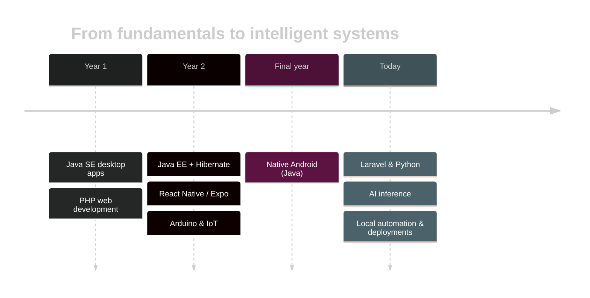
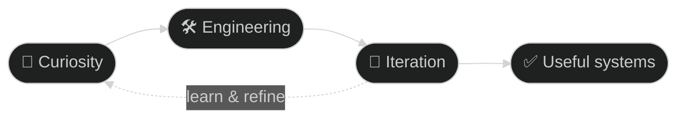

<!-- ═══════════════════════════ HEADER ═══════════════════════════ -->
<div align="center">

<a href="https://github.com/adreysanjunadel">
  
</a>
<br/>


 
<br/>
[](https://www.linkedin.com/in/sanjuna-delpitiya-40b5202a1/)
[](mailto:sanjunadelpitiya1@gmail.com)
[](https://github.com/adreysanjunadel?tab=repositories)

 
</div>
---
 
## `> whoami`
 
```bash
$ whoami
adrien-sanjuna
 
$ cat profile.json
{
  "role":      "Software Engineer (BSc Software Engineering)",
  "location":  "Colombo, Sri Lanka  (UTC+05:30)",
  "company":   "Cornerstone Solutions",
  "roots":     ["Java / Java EE", "PHP", "Mobile development"],
  "today":     ["Laravel", "Python", "JavaScript / TypeScript", "AI-assisted development", "Practical automation"],
  "building":  "software that is understandable, useful and maintainable",
  "philosophy": "purpose-built, lightweight tools over unnecessary complexity"
}
```
 
I work across **backend systems, full-stack applications, AI inference, local automation and deployment workflows**. I enjoy connecting software to real-world engineering problems, from connected devices and business platforms to workflows that are easier to review, maintain and scale.
 
> 💡 *I care about solutions that do more than run: they should be **understandable, useful, and maintainable**.*
 
---
 
## ⚡ What I'm focused on
 
<table>
  <tr>
    <td width="50%" valign="top">
### 🖥️ Backend & web platforms
PHP / Laravel, Java / Java EE, Hibernate, APIs, databases and application workflows.
 
    </td>
    <td width="50%" valign="top">
 
### 🧠 Applied AI & inference
Python-based experimentation, inference integration, and learning how neural networks work from first principles.
 
    </td>
  </tr>
  <tr>
    <td width="50%" valign="top">
### 🔁 Automation & deployment
Local scripts, repeatable developer workflows, Linux tooling, application deployment and operational troubleshooting.
 
    </td>
    <td width="50%" valign="top">
 
### 📐 Engineering automation
Exploring how software can assist engineering design processes, data checks, drawing reviews and human-in-the-loop validation.
 
    </td>
  </tr>
  <tr>
    <td colspan="2" valign="top">
### 📱 Mobile & connected systems
Android (Java), React Native / Expo, Arduino and IoT integrations.
 
    </td>
  </tr>
</table>
---
 
## 🧰 Technical toolkit
 
<div align="center">
| Layer | Stack |
| :--- | :--- |
| **Languages & backend** |  |
| **Frontend & mobile** |  |
| **Tooling & hardware** |  |
 
</div>
<details>
<summary><b>🔎 The full toolkit</b></summary>
<br/>
`Java EE` · `Servlets` · `JSP` · `Hibernate ORM` · `REST APIs` · `React Native / Expo` · `SQL` · `GitHub` · `local development environments` · `debugging & deployment`
 
</details>
> 🧪 **Honest note:** Angular / TypeScript and neural-network fundamentals are active learning interests, not claimed specializations.
 
---
 
## 🚀 Selected public projects
 
*These repositories trace the foundations of my work, from Java applications and mobile development to full-stack systems and connected hardware.*
 
<table>
  <tr>
    <td width="50%" valign="top">
### 🎵 Golden Octaves
**Music eCommerce platform**
 
Product discovery, account workflows, shopping cart and checkout integration.
 
<br/>
<sub><b>Java EE · Hibernate · JS · Bootstrap</b></sub>
 
[](https://github.com/adreysanjunadel/year2_java_web_hibernate_music_shop)
 
    </td>
    <td width="50%" valign="top">
 
### 📡 WiMapsX
**Connected IoT system**
 
Combines a mobile interface, connected hardware and a Java-backed application.
 
<br/>
<sub><b>Arduino · React Native / Expo · Java · Hibernate</b></sub>
 
[](https://github.com/adreysanjunadel/year2_expo_wifi_iot_project)
 
    </td>
  </tr>
  <tr>
    <td width="50%" valign="top">
### 💬 VChat
**Mobile chat app**
 
A mobile chat application built on a Java / Hibernate-backed architecture.
 
<br/>
<sub><b>React Native / Expo · Java · Hibernate</b></sub>
 
[](https://github.com/adreysanjunadel/year2_expo_hibernate_chatapp)
 
    </td>
    <td width="50%" valign="top">
 
### 🚚 Android Delivery Management
**Final-year Android application**
 
Explores delivery management, mobile UI and animations.
 
<br/>
<sub><b>Android · Java</b></sub>
 
[](https://github.com/adreysanjunadel/final_yr_android_delivery_app)
 
    </td>
  </tr>
</table>
<details>
<summary><b>📚 Earlier projects & academic foundations</b></summary>
<br/>
| Project | What it is |
| :--- | :--- |
| [PHP Hotel Web Project](https://github.com/adreysanjunadel/year1_php_hotel_web_project) | Early PHP web application |
| [Java SE Library Management System](https://github.com/adreysanjunadel/year1_java_se_library_sys) | Group desktop application |
| [Java SE Student LMS](https://github.com/adreysanjunadel/year1_java_se_student_lms) | Student-management fundamentals |
| [Java SE Calculator](https://github.com/adreysanjunadel/year1_java_se_calculator) | Foundational Java desktop project |
 
</details>
---
 
## 🗺️ The journey so far
 

 
---
 
## 🧠 Beyond the public repositories
 
Some of my more recent work and exploration isn't represented by a public repository yet. My current direction:
 
| | Direction | Focus |
| :-: | :--- | :--- |
| 🐘 | **Laravel & Python** | Backend application development, scripting and integrations |
| 🤖 | **AI inference & developer tooling** | Practical AI workflows, including reusable AI-assisted codebase mapping and analysis |
| ⚙️ | **Local automation & deployments** | Reducing repetitive work, managing environments, solving deployment issues |
| 📐 | **Cross-disciplinary engineering** | Automating engineering documentation, model information, drawing review and checks that keep engineers in control |
 
---
 
## 🧭 How I build
 

 
- **Clarity over cleverness:** clear architecture and a sensible developer experience.
- **Lightweight over bloated:** purpose-built tools beat unnecessary complexity.
- **Humans in the loop:** automation should assist engineers, not bypass their judgment.
- **Maintainable by default:** if it can't be understood and reviewed, it isn't finished.
---
 
## 📊 GitHub at a glance
 
<div align="center">


<br/>

</div>
---
 
## 🌱 Learning & exploring
 
<div align="center">


 
</div>
Outside code, I'm into **Formula 1 and circuit design 🏎️**, **music 🎶** and **hardware / IoT experimentation 🔌**: places where engineering, creativity and precise systems thinking meet.
 
---
 
## 🤝 Let's connect
 
I'm interested in conversations and collaborations around **backend development, applied AI, automation, mobile systems, IoT and engineering software**.
 
<div align="center">
[](mailto:sanjunadelpitiya1@gmail.com)
[](https://www.linkedin.com/in/sanjuna-delpitiya-40b5202a1/)
[](https://github.com/adreysanjunadel?tab=repositories)
 
[](https://www.instagram.com/adr.sanjuna.del38/)
[](https://www.facebook.com/share/1QeBDeA3Yx/)
 
<br/>
<!-- Optional: needs the snake.yml workflow (see below) -->

<br/>
### `Curiosity → Engineering → Iteration → Useful systems`
 

</div>
 
